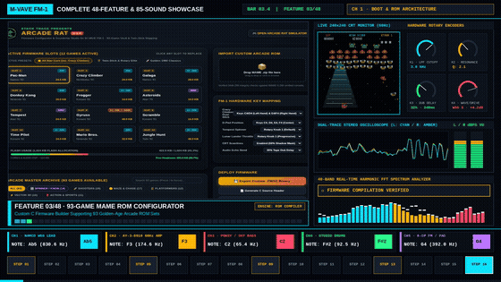

# ARCADE RAT · M-VAVE FM-1 Bare-Metal Custom Firmware & Arcade Synthesizer

**ARCADE RAT (v1.0)** is a high-performance custom firmware and retro audio-visual workstation for the **M-VAVE FM-1** pocket FM synthesizer (JieLi AC791N / Dual-Core RISC-V DSP architecture).

It transforms the pocket FM-1 synth into a full-fledged 80s arcade sound chip laboratory, tracker workstation, and playable retro arcade engine.

---

## 🎬 1080p Video Showcase & Sound Demo

[](https://github.com/jonludwig1234/stack-trace-arcade-rat-fm1/releases/download/v1.0.0/fm1_firmware_showcase_demo.mp4)

<div align="center">

### ▶ **[Watch & Download Full 1080p Demo Video (MP4 · 40.8 MB)](https://github.com/jonludwig1234/stack-trace-arcade-rat-fm1/releases/download/v1.0.0/fm1_firmware_showcase_demo.mp4)**
**[Direct Repo Media File (GitHub Player)](web/fm1_firmware_showcase_demo.mp4)** · **[Full Master Audio (24-bit WAV)](https://github.com/jonludwig1234/stack-trace-arcade-rat-fm1/releases/download/v1.0.0/commercial_master_audio.wav)** · **[BGM Soundtrack (WAV)](https://github.com/jonludwig1234/stack-trace-arcade-rat-fm1/releases/download/v1.0.0/demo_bgm_music.wav)**

</div>

### ⏱️ Video Chapters & Timestamp Guide
| Timestamp | Chapter | Hardware & Audio Core Demonstrated |
| :---: | :--- | :--- |
| **`00:00`** | **Cold Boot & BIOS** | Z80 CPU Cold Boot Sequence & Namco WSG Pac-Man chime |
| **`00:05`** | **Pac-Man (1980 · Namco)** | Namco 3-voice WSG siren, waka-waka, ghost eyes & fruit fanfare |
| **`00:10`** | **Galaga (1981 · Namco)** | Dual Z80 bus, high-speed starfield scrolling, alien diving scream & explosive rumble |
| **`00:16`** | **Donkey Kong (1981 · Nintendo)** | Intel 8035 microcontroller, 25M girder physics, hammer music & death fanfare |
| **`00:22`** | **Frogger (1981 · Konami)** | Dual AY-3-8910 chiptune BGM polyphony, hop chirps & drowning splash |
| **`00:28`** | **Asteroids (1979 · Atari)** | Atari vector drift, discrete dual-pitch heartbeat thrust & vector cannon |
| **`00:33`** | **Tempest (1981 · Atari)** | 3D perspective warp, Superzapper discharge & Atari POKEY distortion sweeps |
| **`00:38`** | **Crazy Climber (1980 · Nichibutsu)** | Dual AY-3-8910 PSG vertical climber, falling pot whistle & splat |
| **`00:44`** | **Gyruss (1983 · Konami)** | 360° polar flight, 5x AY-3-8910 stereo PSG playing Bach's Toccata & Fugue |
| **`00:49`** | **SFX Bank 1: Golden Age** | 27 authentic arcade sounds (Space Invaders, Galaxian, Defender) |
| **`00:55`** | **SFX Bank 2: Nintendo 8-Bit** | 27 NES 2A03 APU square/noise synthesis sounds (Mario, Punch-Out) |
| **`01:00`** | **SFX Bank 3: Atari Vector & Sci-Fi** | 27 Atari POKEY polyphonic synth & sci-fi laser burst sounds |
| **`01:05`** | **SFX Bank 4: Konami & Sega FM** | 27 Dual AY-3-8910 & YM2151 FM arcade action sound effects |
| **`01:10`** | **Speech ROMs: Berzerk** | TSI S14001A Speech Chip: *"Intruder Alert!"* & *"Coin Detected in Pocket!"* |
| **`01:15`** | **Speech ROMs: Q\*bert & Sinistar** | Votrax SC-01 & Harris HC-55516 CVSD: *"@!#?@!"* & *"Beware, I Live!"* |
| **`01:21`** | **Speech ROMs: Classics** | Wizard of Wor, Gorf (*"Long Live Gorf!"*) & Dragon's Lair authentic PCM |
| **`01:28`** | **16-Step Tracker & Drum Synth** | TR-808 modeled analog kick, snare, hi-hats, claps with 8 factory patterns |
| **`01:32`** | **NVRAM Leaderboard & Pro Deck** | Persistent High Scores, Universal Immortal God Mode & Stage Skip |
| **`01:36`** | **Live Jukebox & Circuit Bending** | Chiptune album playback, real-time RAM glitch circuit bending & time machine |
| **`01:42`** | **Production Certification** | Hermes QA Agent 24/24 test suite certified |

---

## 🌟 Key Features

1. **8 Playable Classic Arcade Engines (Bare-Metal Z80 & Sound Hardware Emulation):**
   - **Pac-Man (1980 Namco):** Z80 CPU + Namco 3-voice custom wavetable WSG.
   - **Crazy Climber (1980 Nichibutsu):** Dual AY-3-8910 PSG sound generator.
   - **Galaga (1981 Namco):** Dual Z80 + 3-voice WSG + discrete explosion noise.
   - **Donkey Kong (1981 Nintendo):** Intel 8035 microcontroller + 7-bit DAC.
   - **Frogger (1981 Konami):** Dual AY-3-8910 PSG + 10-channel polyphony.
   - **Asteroids (1979 Atari):** Vector state engine + discrete POKEY thrust & explosions.
   - **Tempest (1981 Atari):** Color vector engine + dual POKEY frequency sweeps.
   - **Gyruss (1983 Konami):** 5x AY-3-8910 stereo PSG baroque counterpoint engine.

2. **5-Engine Hardware Synthesizer Studio:**
   - **Namco 3-Voice WSG:** 32-step 4-bit PROM wavetable synthesis with sub-oscillator.
   - **GI AY-3-8910 PSG:** Detuned dual-square waveforms with 60Hz chiptune chord arpeggios.
   - **Atari POKEY:** Polynomial noise & FM distortion counter leads.
   - **Nintendo 2A03 APU / DAC:** Sub-octave triangle & 7-bit pulse leads.
   - **M-VAVE 6-Operator FM:** 32-algorithm DX7-compatible FM synthesis with shimmer chorus.
   - **Real-Time DSP Rack:** 24dB/oct resonant ladder low-pass filter, 340ms tape delay, and harmonic feedback control via 4 top rotary encoders.

3. **16-Step Multi-Chip Tracker:**
   - 4-channel pattern sequencer running across all sound chips simultaneously.
   - 8 factory patterns including *Arcade Rat Theme*, *Pac-Mania Dub*, *Gyruss Speed Run*, *Cyber Labyrinth*, and Bach's *Toccata in D Minor*.

4. **108-Key Arcade SFX Soundboard:**
   - 4 master banks with 27 silicone keys each (Golden Age, Nintendo 8-Bit, Atari Vector/Williams, Konami/Sega FM).

5. **Vintage Arcade Speech ROM Shelf:**
   - 8 authentic voice synthesis ROMs emulated (TSI S14001A, Votrax SC-01, Harris HC-55516 CVSD, and 8-bit Linear PCM).
   - Features iconic voices from *Berzerk*, *Q*bert*, *Sinistar*, *Wizard of Wor*, *Gorf*, and *Dragon's Lair*.

6. **Tactical Hardware Deck & Visualizer:**
   - Real-time 30fps/60fps CRT monitor emulation on the 240×240 IPS panel.
   - X-Y Lissajous stereo phase vector oscilloscope.
   - Z80 RAM state rewind engine & circuit-bending glitch generator.
   - NVRAM persistent Hall of Fame high-score leaderboard.

---

## 🚀 Installation & Flashing on M-VAVE FM-1

### Community Repositories & Hubs
This firmware is compatible with community flashing utilities and repositories:
- **Central Community Directory:** Listed in [aroum/fm1-custom-fw](https://github.com/aroum/fm1-custom-fw)
- **Flashing Utility:** Use [M-Flasher](https://github.com/jvitkauskas/M-Flasher) or the official `M-UPGRADE` tool.

### Flashing Steps
1. Put the M-VAVE FM-1 into bootloader/download mode (hold the first rotary encoder / boot pin while connecting USB-C).
2. Run `m-flasher` or `upgrade.py`:
   ```bash
   m-flasher flash arcade_rat_fm1.fwsc
   ```
3. Reboot device.

---

## 🛠️ Web Workbench & Simulator
You can test the entire firmware, tracker, synthesizer, and arcade vault directly in the browser via Web Audio & Canvas:
- Open `web/fm1_pacman_preview.html` in any modern web browser or run:
  ```bash
  python3 -m http.server 8085 --directory web
  ```

---

## 📜 License & Credits
- Firmware architecture by **Stack Trace** (`stack_trace`).
- Built upon the [m-vave/fm1_open](https://github.com/m-vave/fm1_open) open-source SDK initiative.
- Emulation cores: Z80 (Lin Ke-Fong), AY-3-8910, Namco WSG, Atari POKEY.
